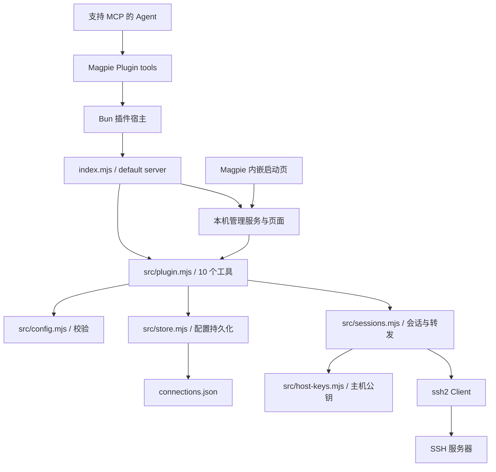
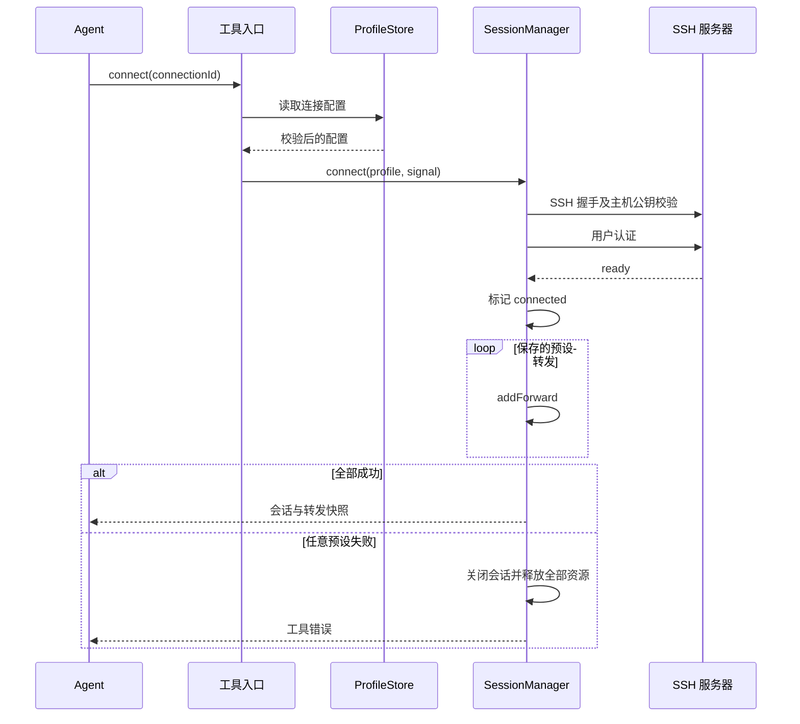
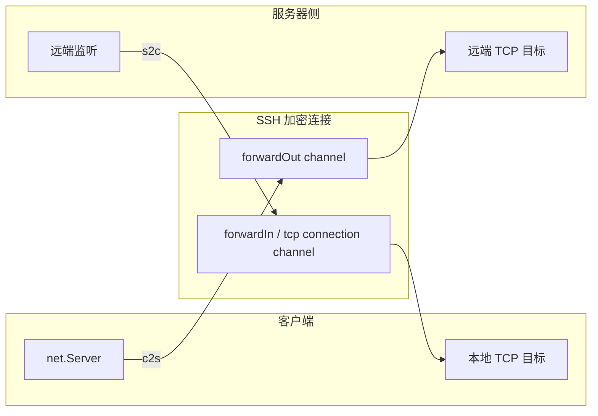
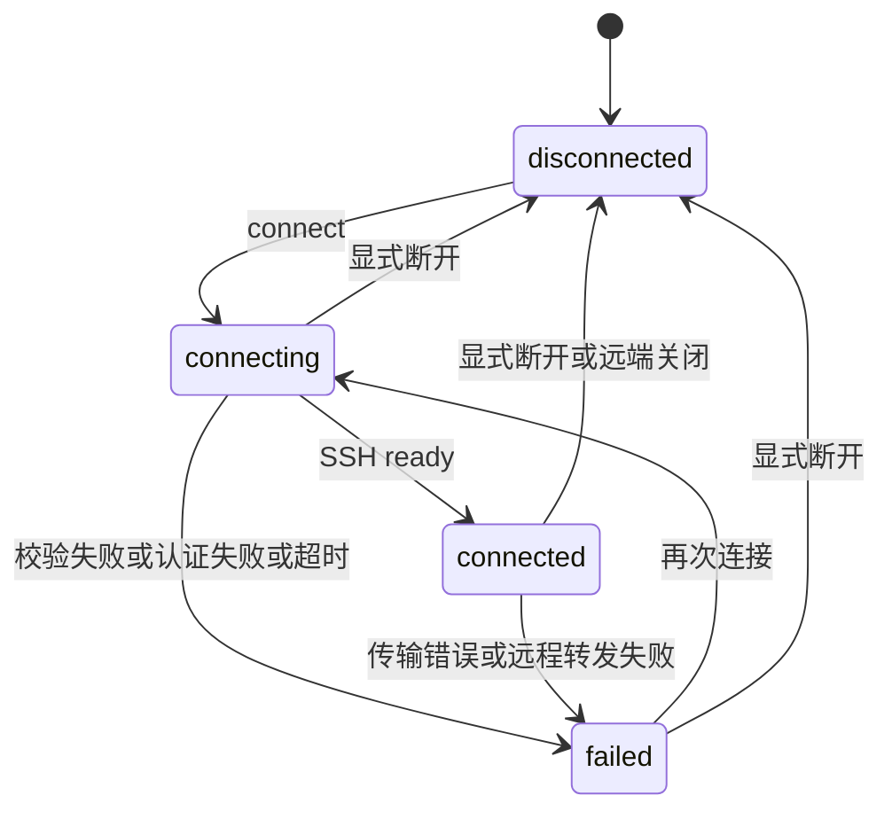

# 架构说明

## 模块关系

插件只导出一个 OpenCode v1 对象，辅助函数放在 `src/`。`createPlugin` 默认启动只监听回环地址的管理服务，并在 `page/.runtime/` 发布启动地址；不会自动建立 SSH 连接。每个连接拥有自己的 SSH 客户端、转发映射和 TCP 资源集合。

## 连接与预设转发

工具入口按连接 id 串行处理修改、连接与转发操作，独立连接可以并行。断开操作会立即取消同一连接等待中的连接请求。配置写入另有进程内串行队列；临时文件写完后重命名替换，避免留下半个 JSON。

## TCP 数据路径

c2s 在本地监听，每条入站 TCP 连接通过 `forwardOut` 建立独立 SSH 通道。s2c 通过 `forwardIn` 请求服务器监听，收到与已登记端口匹配的连接后才连接本地目标并接受 SSH 通道。流通过 Node/Bun stream 的 `pipe` 转发并保持背压。

关闭转发会销毁它的活跃通道和 socket；关闭会话会销毁 SSH 客户端，并关闭所有本地监听。远端监听随 SSH 连接终止释放。转发不执行远程 shell，也不解析应用协议。

## 生命周期与边界

配置和预设保存在文件中；会话、当前动态端口和临时转发仅保存在宿主内存中。宿主重载后需要重新连接。当前配置目录不具备跨进程写锁。

Magpie 公开页面桥接只提供受限读取和插件选项操作。启动页完成握手后，在当前 iframe 内导航到独立回环管理服务。服务通过自己的随机访问标识与 API 认证调用共用工具，不调用 Magpie 管理 API，也不修改其 iframe 沙箱。页面支持原生主题消息、配置管理、连接控制和转发操作。插件宿主具备网络和文件权限，主机信任由本插件显式校验。

源码依据：[入口](../index.mjs)、[工具](../src/plugin.mjs)、[校验](../src/config.mjs)、[存储](../src/store.mjs)、[会话](../src/sessions.mjs)、[主机公钥](../src/host-keys.mjs)。官方运行边界见 [Magpie 插件文档](https://usemagpie.ai/docs/plugins)。返回[文档导航](README.md)。
