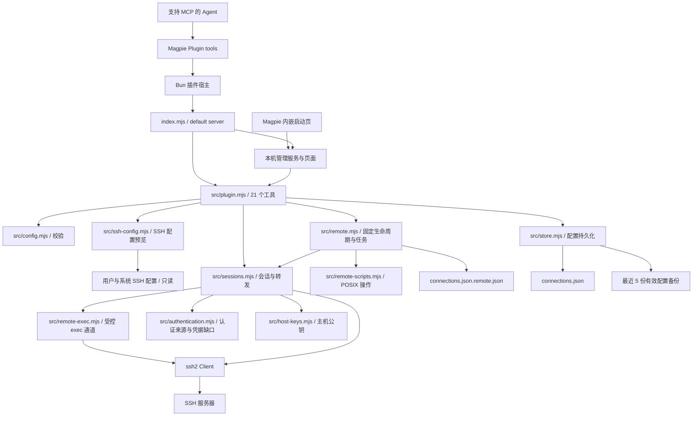
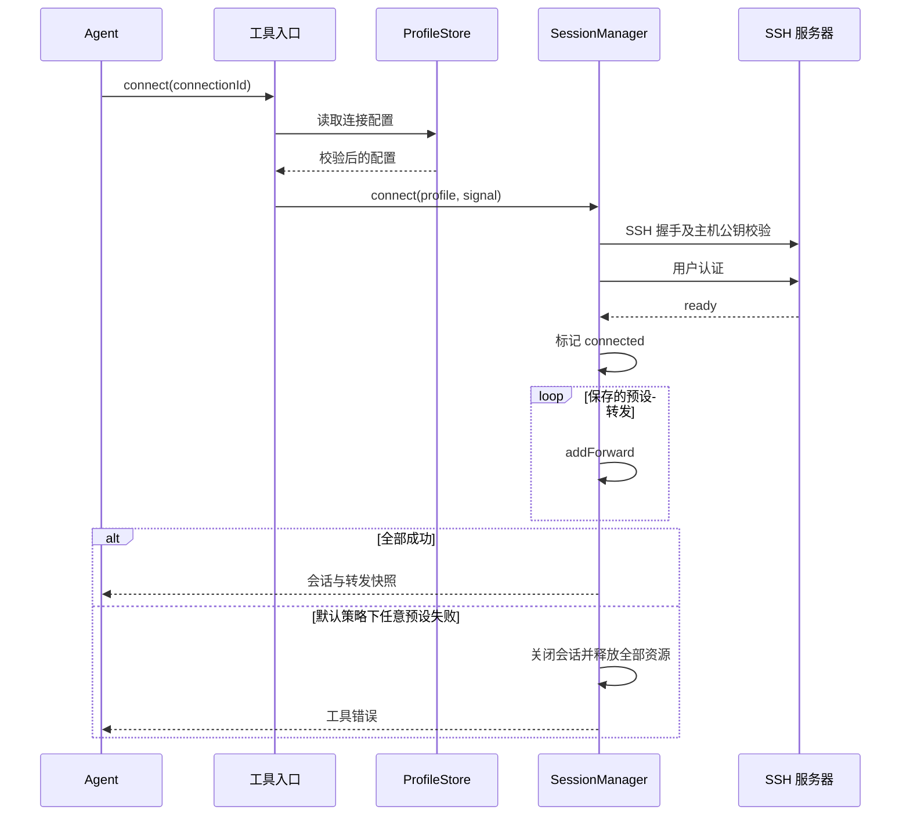
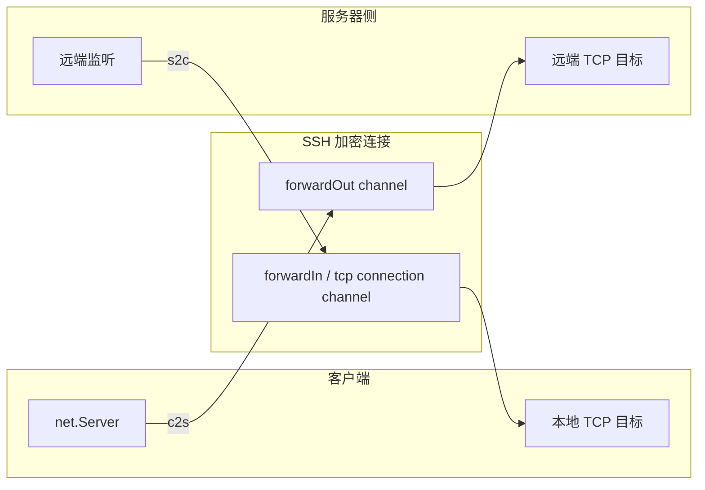
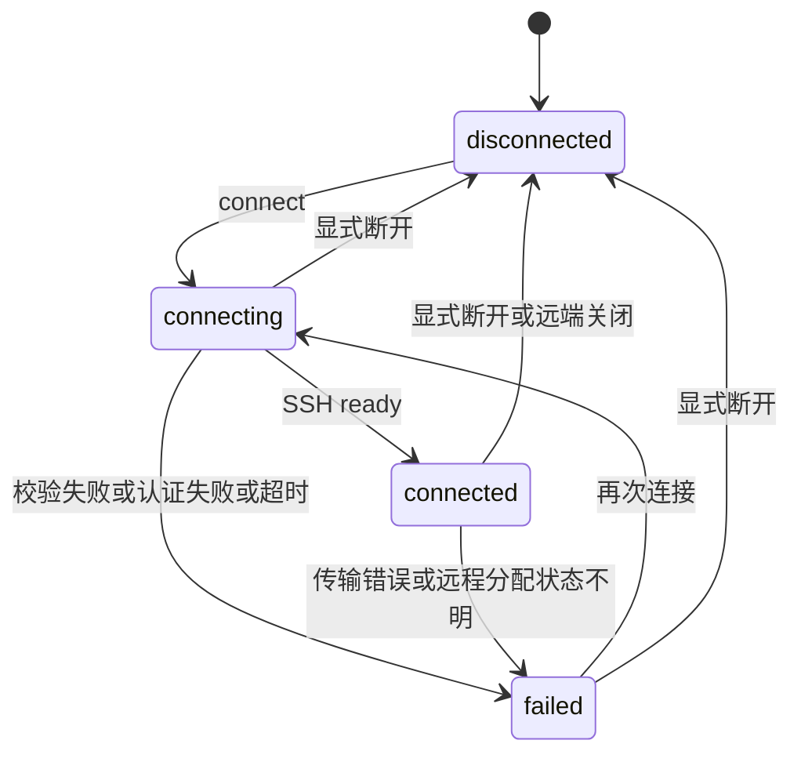

# 架构说明

## 模块关系

插件只导出一个 OpenCode v1 对象，辅助函数放在 `src/`。`createPlugin` 默认启动只监听回环地址的管理服务，并在 `page/.runtime/` 发布启动地址；仅对 `autoConnect` 为 true 的配置尝试连接一次。每个连接拥有自己的 SSH 客户端、转发映射和 TCP 资源集合。

## 连接与预设转发

工具入口按连接 id 串行处理修改、连接与转发操作，独立连接可以并行。断开操作会立即取消同一连接等待中的连接请求。配置写入另有进程内串行队列；临时文件写完后重命名替换，避免留下半个 JSON。

连接列表额外返回每条规范化配置的内容 revision。普通替换、预设保存和删除携带 expectedRevision，在写入队列中重新比较，防止旧页面或 MCP 覆盖新修改。新建仅允许不存在的 id；没有版本的旧更新会明确拒绝。版本不写入 version 1 配置或备份。页面编辑基线在弹窗打开时固定，保存成功返回新版本供下一次操作使用；跨进程写锁仍不在当前范围内。

`forwardFailurePolicy: "continue"` 可选择在可恢复的预设错误后继续启动后续规则，失败原因放入独立的 `forwardErrors` 快照，不伪装成正在运行的转发。服务器明确回复请求失败时，仅移除失败规则；远程分配超时、取消或传输失败仍终止会话，避免遗留状态未知的监听。默认策略保持全部回滚。

认证准备独立检查 agent、私钥和密码来源；备用来源不可用不会阻断其他可用来源。私钥先解析以区分未加密、缺口令与无效文件，只有需要补充凭据时返回 `CREDENTIALS_REQUIRED`。管理服务将结构化错误传给页面，页面分别处理配置修复、地址过期、网络不可达与请求超时；本次输入的凭据不进入持久化配置或快照。

密码认证使用 `passwords.mjs`：管理页在保存请求的独立凭据字段中提交密码，配置存储只写入 AES-256-GCM 密文。每次加密生成随机 12 字节 IV，使用 16 字节认证标签，并以连接标识、地址、端口和用户名作为认证附加数据；修改服务器信息时在后端重新绑定。32 字节随机密钥单独存放在 `connections.json.key`，以完整临时文件的硬链接原子发布，避免并发创建覆盖密钥。Unix 权限为 0600，Windows 继承数据目录 ACL；配置和密钥同时泄露仍可解密。连接列表和保存结果只返回 `hasSavedPassword`，不会返回密文或明文。备份保留密文而不包含密钥；缺失密钥和完整性校验失败均请求重新输入，不在解密时生成替代密钥。实现使用 [Node.js 认证加密接口](https://nodejs.org/api/crypto.html)。

## 自动重连与错误隔离

`SessionManager` 为每个连接独立维护用户连接意图、期望运行的转发、退避计时器与尝试控制器。会话状态继续使用原有四种枚举，`reconnect` 单独描述等待、尝试、暂停和停止。每次尝试复用清理完成的承诺，旧客户端释放本地监听与通道后才建立新客户端；回调核对当前意图和会话，避免旧回调重新安排连接。

`errors.mjs` 将错误分为网络、认证、凭据、主机信任、配置、转发和取消。只有明确可重试的网络错误触发退避，默认关闭自动重连。延迟从约 1 秒指数增加，带抖动且不超过 30 秒，稳定连接 30 秒后重置；持续网络故障继续按上限重试。手动断开、恢复配置和插件关闭会清除计时器并取消进行中的尝试。每次重连重新读取认证来源和主机信任，可按需解密已保存密码，本次输入的凭据不保存在重连意图中。

期望转发初始来自自动启动的预设，手动启动会加入，手动停止或删除会移除；自动重连保留这份意图，手动断开后的新连接重新使用已保存的预设。一个会话的故障只清理自己的资源，其他会话继续工作。单条转发的可恢复失败沿用 `forwardFailurePolicy`，无法确认远端分配结果时仍关闭会话，且不自动重试未知分配故障。

## 配置备份恢复

`ProfileStore` 的同一写入队列处理普通修改、手动备份和恢复。普通修改先验证旧配置，有实际内容变化时将旧配置写入同目录的 `.backups/`，再原子替换主文件；提交成功后才轮换，保留最近 5 份有效快照。备份失败不替换主文件；主文件替换失败则只尝试移除本次未提交的快照，不删除已有历史。提交后的清理失败通过独立警告报告，允许暂时超出上限，并在下次成功写入或手动备份时重新清理。读备份独立于读主配置，一个损坏文件不会使其他备份不可用。备份名称只接受 UUID，读取时拒绝非普通文件。

预览的 revision 覆盖备份标识、备份内容和当前配置原始字节；恢复在写队列内重新校验，避免覆盖预览后的修改。工具层持有恢复门闩，阻止新的配置或会话修改；明确允许停止后取消连接队列和重连意图，等待进行中的操作结束，再执行恢复。有效旧配置保存为恢复前备份，损坏旧文件完整写入 `.recovery/` 后才替换。恢复不自动启动连接；已取消的会话在恢复失败时也保持停止。

备份只保存校验后的配置，密码保持密文，不复制本机解密密钥、临时凭据或私钥内容；当前没有跨进程锁或异地备份。Windows 权限沿用父目录，POSIX 新备份目录为 `0700`、文件为 `0600`。

## SSH 配置导入

预览工具读取用户与系统配置及 Include 文件，计算有效的主机候选和 revision，并附加现有连接 id 的冲突标记。导入工具重新读取并核对 revision，只把用户所选且受支持的连接交给 `ProfileStore.importProfiles`。它与其他配置写入共用串行队列，在同一次原子替换中新增连接并跳过已有 id，不覆盖旧配置。源文件和当前 SSH 会话不参与写入；读取阶段不执行命令。

完整映射、限制及管理页接入说明见 [SSH 配置导入](ssh-import.md)。

## 远程 Magpie 生命周期

`RemoteManager` 复用已认证 SSH 会话，只允许预定义的安装、更新、服务启停、启用 Web 和卸载动作。预览探测当前用户环境并固定连接版本、程序和服务文件哈希；提交先持久化任务，再异步复核和执行。管理 HTTP 请求结束不取消已提交任务，页面通过同一工具读取进度。

`remote-exec.mjs` 为每次请求独立处理标准输入、UTF-8 双输出、大小上限、超时、退出状态与通道清理。更新口令仅经标准输入交给官方加密备份命令，不存入脚本或任务记录。远端脚本用原子目录创建实现操作互斥，并保存完成记录；超时、断线或缺退出码的任务保持 `unknown`，只有明确完成记录及已释放的锁能核实终态。插件重启同样将原运行任务标为待核实，禁止自动重放。

本地独立状态文件保存每连接的最近环境和最新任务，损坏时拒绝覆盖。运行或待核实任务阻止删除连接、全局恢复和改指向其他服务器；待核实任务允许修复同一服务器的认证配置。官方 Web 链接仅显式读取，通过临时回环 c2s 转发访问，密钥不进入本地记录；供应商与 Agent 由官方页面管理。具体范围见[远程 Magpie 管理](remote.md)。

## TCP 数据路径

c2s 在本地监听，每条入站 TCP 连接通过 `forwardOut` 建立独立 SSH 通道。s2c 通过 `forwardIn` 请求服务器监听，收到与已登记端口匹配的连接后才连接本地目标并接受 SSH 通道。流通过 Node/Bun stream 的 `pipe` 转发并保持背压。

关闭转发会销毁它的活跃通道和 socket；关闭会话会销毁 SSH 客户端，并关闭所有本地监听。远端监听随 SSH 连接终止释放。转发不执行远程 shell，也不解析应用协议。

每条转发按实际请求记录 targetConnection。请求持有自己的尝试标识，只有最近发起的请求可以更新当前结果，迟到的旧回调不能覆盖恢复状态；快照中的嵌套错误也会复制。目标建立超时只关闭该请求，记录错误并保留监听，下一次成功请求清除当前错误并记录恢复。监听状态与目标连接结果独立，均不代表应用健康。

## 生命周期与边界

配置和预设保存在文件中；会话、当前动态端口和临时转发仅保存在宿主内存中。宿主重载后需要重新连接。当前配置目录不具备跨进程写锁。

删除连接先完成带版本校验的配置写入，再取消对应意图、等待资源清理并移除会话映射。写入失败时保留运行记录；普通断开仍保留日志。会话回调继续校验当前意图和会话身份，已删除记录不能被旧回调重新注册。

Magpie 公开页面桥接只提供受限读取和插件选项操作。启动页完成握手后，在当前 iframe 内导航到独立回环管理服务。服务通过自己的随机访问标识与 API 认证调用共用工具，不调用 Magpie 管理 API，也不修改其 iframe 沙箱。页面支持原生主题消息、配置管理、连接控制和转发操作。插件宿主具备网络和文件权限，主机信任由本插件显式校验。

源码依据：[入口](../index.mjs)、[工具](../src/plugin.mjs)、[校验](../src/config.mjs)、[存储](../src/store.mjs)、[会话](../src/sessions.mjs)、[主机公钥](../src/host-keys.mjs)。官方运行边界见 [Magpie 插件文档](https://usemagpie.ai/docs/plugins)。返回[文档导航](README.md)。
