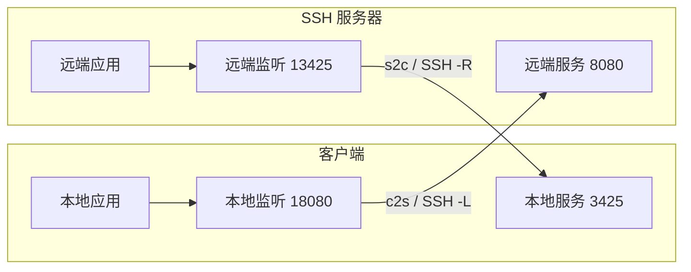

# 操作指南

## 连接配置与认证

安装和接入步骤见[项目说明](../README.md)。配置由 `save_connection` 工具写入，工具完整名称与参数见[工具接口](tools.md)。

连接必须提供 `id`、`host` 和 `username`。`host` 应填写实际主机名或 IP；当前不会读取 OpenSSH `config` 中的 Host 别名、ProxyJump 或 ProxyCommand。

支持的认证方式：

| 字段 | 示例与用途 |
| --- | --- |
| `identityFile` | `~/.ssh/id_ed25519`；读取私钥文件，支持绝对路径和 `~/` |
| `agent` | SSH agent socket；Windows OpenSSH agent 可填写命名管道 |
| `passwordEnv` | 例如 `DEV_SERVER_SSH_PASSWORD`；值从插件宿主环境读取 |
| `passphraseEnv` | 加密私钥的口令环境变量名 |

未指定 `agent` 时，会使用插件宿主环境中的 `SSH_AUTH_SOCK`；选择 `authMethod: "agent"` 且 Windows 未提供该变量时，使用系统 OpenSSH agent 命名管道。不会自动搜索私钥。MCP 工具使用上述配置认证；可视化页面还可输入本次密码 / 私钥口令，不写入配置。Windows OpenSSH agent 配置示例：

```json
{
  "connection": {
    "id": "windows-agent",
    "host": "server.example.com",
    "username": "developer",
    "agent": "\\\\.\\pipe\\openssh-ssh-agent"
  }
}
```

密码或口令需要在启动 Magpie 的环境中提供。修改某个终端的环境变量，不会更新已经运行的 Magpie 进程。配置文件拒绝 `password`、`passphrase`、`privateKey` 等原文内容字段；仅保存环境变量名和文件路径。

管理页的「新建 SSH 连接」按基本信息、认证方式和连接行为分区。默认选择 SSH agent，可切换为私钥文件或环境变量；高级认证设置用于填写私钥路径、私钥口令和密码的环境变量名称。环境变量方式未填写密码变量时，可在连接时输入本次密码。主机指纹、known_hosts 路径、自定义 agent 地址和连接标识位于「主机校验与其他设置」。新建时点击「保存并连接」会先保存配置，再尝试连接；编辑现有连接时只保存修改。

`authMethod` 可为 `agent`、`key` 或 `environment`，指定优先尝试的认证来源，其他已配置凭据可用于回退。「连接成功后自动启动预设转发」对应 `autoStartForwards`，默认开启；关闭后仍保留预设，可在连接成功后手动启动。「应用启动时尝试重新连接」对应 `autoConnect`，默认关闭；开启后，插件宿主启动或重载时尝试连接一次。该行为需要可用的 agent、私钥或宿主环境变量，本次输入的密码和口令不会保存。

## 主机公钥

默认读取当前用户的 `~/.ssh/known_hosts`，支持普通主机、非 22 端口、哈希主机名、通配模式、排除模式和 `@revoked`。可通过 `knownHostsFile` 指向另一个文件。当前不支持 `@cert-authority` 证书信任。

也可以填写 `hostFingerprint`，格式为 `SHA256:` 加上不带末尾 `=` 的 43 位 Base64 指纹。提供指纹时按指纹校验；对应主机在 known_hosts 中被标为撤销的相同密钥仍会拒绝。

第一次连接前，可使用现有 OpenSSH 工具建立正常的主机信任记录，或从服务器管理员处获得主机公钥指纹。公钥不可信或发生变化时，连接失败，`status` 中的 `hostFingerprint` 可辅助核对；插件不会自动信任首次看到的公钥。

## c2s 与 s2c



| 字段 | c2s | s2c |
| --- | --- | --- |
| `bindHost` / `bindPort` | 客户端的监听地址和端口 | SSH 服务器的监听地址和端口 |
| `targetHost` / `targetPort` | 从服务器侧访问的目标 | 从客户端侧访问的目标 |
| `bindPort: 0` | 由客户端系统分配端口 | 请求服务器分配端口 |

两个方向的 `bindHost` 和 `targetHost` 均默认 `127.0.0.1`。`bindPort` 和 `targetPort` 必填，`targetPort` 不接受 0。动态端口的实际值由 `forward_add` 返回，也可以从 `status` 查看。

操作顺序为：保存连接 → `connect` 成功 → `forward_add`。若连接配置包含 `forwards` 且 `autoStartForwards` 未设为 false，插件会在认证成功后逐条启动这些预设；任意一条失败会关闭该次会话并回收已启动的转发。动态创建的转发失败时，c2s 的本地端口冲突不影响已有会话；s2c 失败会关闭会话以避免遗留远程监听。

`forward_remove` 停止单条转发，并关闭其正在传输的 TCP 通道。`disconnect` 关闭整个会话。转发状态 `listening` 表示监听已建立，目标服务是否可访问要通过实际应用请求确认；失败原因可在 `lastError` 中查看。

SSH 服务器需允许相应方向的 TCP 转发。OpenSSH 的 `AllowTcpForwarding` 控制许可，`PermitOpen` / `PermitListen` 可进一步约束目标或监听，`GatewayPorts` 影响远端监听的绑定地址。非回环绑定是否生效取决于服务器策略，见 [OpenSSH 服务端配置](https://man.openbsd.org/sshd_config)。

## 保存位置与会话生命周期

默认文件是 Magpie 传入的配置目录下的 `migpie-remote/connections.json`。可通过插件选项指定独立数据目录：

```json
{
  "dataDirectory": "D:/my-magpie-data/migpie-remote",
  "connectTimeoutMs": 15000,
  "forwardTimeoutMs": 10000
}
```

在插件的选项编辑器中保存这些选项后，重新加载插件使其生效。连接超时允许 100–45000 ms；转发操作超时允许 100–15000 ms。默认保活间隔为 15 秒，最多连续 3 次无响应。

配置采用临时文件加重命名写入，并串行处理本进程内的配置修改。同一数据目录应由一个持续运行的宿主写入，不支持多个 Magpie 宿主并行修改同一连接文件。POSIX 上新文件使用 `0600` 权限；Windows 使用父目录继承的访问权限。

插件关闭、宿主退出或重载会结束当前 SSH 会话。保存的配置仍在，下次可点击页面连接按钮或调用 `connect`；开启 `autoConnect` 的连接会在插件宿主启动时尝试连接一次，预设转发按 `autoStartForwards` 设置启动。管理页刷新不会断开 SSH；宿主重载后可点击「重新打开」发现新的本机服务地址。当前不包含断线后循环重试、交互式终端、SFTP/文件传输、SOCKS 动态代理或 UDP 转发。

## 管理页面

页面采用连接列表与详情双栏布局。顶部汇总已建立的连接和运行中的转发，并可切换全部、已连接、未连接；搜索支持名称、用户名和主机地址。

选中连接后，默认显示端口转发。连接菜单提供连接、设置、编辑与删除入口；已连接时可重新连接。密码和私钥口令在连接对话框中填写，提交或关闭后清空，不持久保存。连接时长每秒更新，断开后保留最近一次成功连接时间。

「导入配置」读取本机 OpenSSH 配置，支持指定文件、预览与勾选主机、可选导入转发预设。已有连接会跳过，不支持的代理等配置显示原因；导入完成后不自动连接。完整规则见 [SSH 配置导入](ssh-import.md)。

转发支持中文显示名称，内部标识保持独立。已连接时可创建并启动，未连接时保存预设；启动预设遵循连接的「自动启动预设转发」设置。运行中的规则需先停止再编辑，也可直接删除并停止。

「运行日志」显示后端真实的认证、断线、转发启停和错误事件，支持只看错误。每个连接保留最近 200 条，重连后继续保留；日志仅保存在宿主内存中，宿主重启后清空。页面适配浅色、深色与窄屏，窄屏可收起连接列表。

## 常见问题

| 现象 | 检查方向 |
| --- | --- |
| 工具没有出现 | 插件加载错误、所用 Magpie 是否提供 Plugin tools、Agent 是否接入了正确的 MCP 地址 |
| 提示主机公钥不可信 | `host`、`port`、known_hosts 的对应记录及指纹是否匹配 |
| 密码环境变量未设置 | 提供变量的进程是否是实际启动插件宿主的 Magpie |
| 认证失败 | SSH 用户、密钥权限、agent 中的密钥、服务器允许的认证方法 |
| c2s 提示端口占用 | 本地端口是否已有监听；也可以使用 `bindPort: 0` |
| s2c 被拒绝 | sshd 转发许可、远端端口占用、监听地址限制 |
| 已监听但应用无法访问 | 目标地址属于哪一侧、目标应用状态、应用本身的认证和协议 |
| 修改或删除配置被拒绝 | 先调用 `disconnect`，再保存或删除配置 |

实现依据：[配置校验](../src/config.mjs)、[主机公钥](../src/host-keys.mjs)、[会话与转发](../src/sessions.mjs)。返回[文档导航](README.md)。
