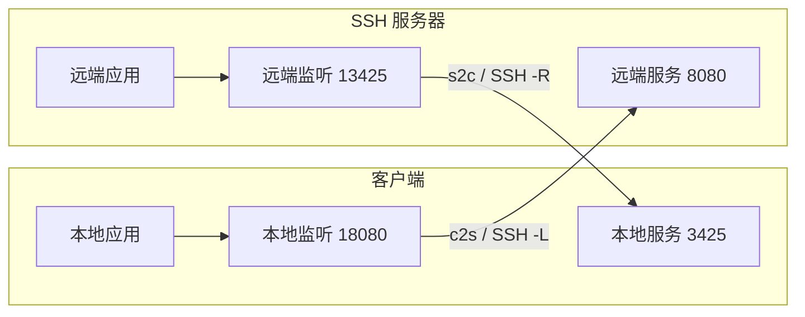

# 操作指南

## 连接配置与认证

安装和接入步骤见[项目说明](../README.md)。配置由 `save_connection` 工具写入，工具完整名称与参数见[工具接口](tools.md)。

连接必须提供 `id`、`host` 和 `username`。`host` 应填写实际主机名或 IP；当前不会读取 OpenSSH `config` 中的 Host 别名、ProxyJump 或 ProxyCommand。

支持的认证方式：

| 字段 | 示例与用途 |
| --- | --- |
| `authMethod: "password"` | 在管理页直接输入并加密保存登录密码，下次连接时自动使用 |
| `identityFile` | `~/.ssh/id_ed25519`；读取私钥文件，支持绝对路径和 `~/` |
| `agent` | SSH agent socket；Windows OpenSSH agent 可填写命名管道 |
| `passwordEnv` | 例如 `DEV_SERVER_SSH_PASSWORD`；值从插件宿主环境读取 |
| `passphraseEnv` | 加密私钥的口令环境变量名 |

未指定 `agent` 时，会使用插件宿主环境中的 `SSH_AUTH_SOCK`；选择 `authMethod: "agent"` 且 Windows 未提供该变量时，使用系统 OpenSSH agent 命名管道。不会自动搜索私钥。MCP 工具使用上述配置认证；可视化页面还可输入本次密码 / 私钥口令，不写入配置。Windows OpenSSH agent 配置示例：

```json
{
  "connection": {
    "id": "windows-agent",
    "host": "server.example.com",
    "username": "developer",
    "agent": "\\\\.\\pipe\\openssh-ssh-agent"
  }
}
```

使用环境变量时，密码或口令需要在启动 Magpie 的环境中提供。修改某个终端的环境变量，不会更新已经运行的 Magpie 进程。配置文件仍拒绝 `password`、`passphrase`、`privateKey` 等原文字段；密码认证使用后端生成的 `encryptedPassword` 密文。

管理页的「新建 SSH 连接」按基本信息、认证方式和连接行为分区。默认选择 SSH agent，可切换为密码、私钥文件或环境变量。选择「密码」后直接填写登录密码，点击「保存并连接」会先加密保存，再使用已保存的密码登录，无需第二次填写。编辑已有密码连接时，输入框不回显密码；留空保留已保存的密码，输入新密码则替换。切换为其他认证方式并保存会移除当前配置中的密码密文。高级认证设置用于填写私钥路径、私钥口令和密码的环境变量名称；环境变量方式未填写密码变量时，可在连接时输入本次密码。主机指纹、known_hosts 路径、自定义 agent 地址和连接标识位于「主机校验与其他设置」。编辑现有连接时只保存修改。

密码通过 AES-256-GCM 加密并绑定连接标识、服务器地址、端口及用户名，随机密钥存放在数据目录的 `connections.json.key`，不进入配置、页面快照、工具返回或配置备份。Unix 上密钥仅当前用户可读写；Windows 沿用数据目录的访问权限，应使用当前用户的私有目录。这保护单独泄露的配置和备份；同时取得配置与密钥的进程仍可解密，因此整个数据目录仍需妥善保管。跨机器迁移时需单独安全迁移密钥，或重新填写密码；密钥丢失、密文损坏时不会自动覆盖密钥，连接会提示重新输入。

`authMethod` 可为 `password`、`agent`、`key` 或 `environment`，指定优先尝试的认证来源，其他已配置凭据可用于回退。「连接成功后自动启动预设转发」对应 `autoStartForwards`，默认开启；关闭后仍保留预设，可在连接成功后手动启动。「应用启动时尝试重新连接」对应 `autoConnect`，默认关闭；开启后，插件宿主启动或重载时尝试连接一次。该行为可以使用加密保存的密码、可用的 agent、私钥或宿主环境变量；凭据弹窗中仅用于本次的密码和口令不会保存。

点击连接时先尝试已有认证来源。未加密私钥不要求口令；缺少密码或加密私钥口令时，页面只提示需要的输入项，错误口令可直接重试。备用私钥不可读、格式错误或备用环境变量未设置时，仍会尝试其他可用来源，并在日志中说明原因。也可从「连接设置 → 填写凭据并连接」主动输入本次凭据。

首次连接可展开「连接设置 → 首次连接与认证排错」按主机、信任、认证和宿主环境顺序检查。失败后页面会按结构化错误提供修复引导：主机信任要求从控制台或管理员独立核验 SHA256；agent 认证可在运行 Magpie 的同一账户下用 `ssh-add -l` 检查身份，Windows 检查 OpenSSH Authentication Agent 服务与命名管道，其他系统检查 `SSH_AUTH_SOCK`；环境变量修改后需重新加载宿主。页面不会提供自动信任或自动更换公钥操作。

## 断网自动重连

连接编辑器中的「网络中断后自动重连」对应 `autoReconnect`，默认关闭，与启动时连接的 `autoConnect` 独立。开启后，首次连接遇到网络错误，或已建立的会话因网络中断、超时或远端关闭而断开时，会先清理本次监听和通道，再自动尝试连接。

重试按约 1、2、4、8、16、30 秒逐步延长，加入少量随机抖动，间隔不超过 30 秒；连接稳定 30 秒后重置次数。持续网络故障会继续按上限间隔重试。静默断网由保活检测，默认每 15 秒检查、最多连续 3 次无响应，因此不会在断网瞬间就开始重连。页面显示等待、下一次尝试时间和暂停原因，也可「立即重试」。每次尝试都重新验证主机公钥与认证来源。

认证失败、主机公钥不可信、私钥或配置不可用、转发拒绝或分配状态不明时，不会循环尝试；修复后手动连接。自动重连可重新解密已保存的密码；仅本次输入的密码和私钥口令不会保留给自动重连，若没有其他可用来源，重连暂停，手动连接时重新填写。

自动重连会恢复本轮会话仍需要运行的转发，包括手动启动的临时转发；手动停止、删除的规则不恢复，后来仅保存而未启动的预设也不会自行启动。「立即重试」在配置未改变时保留这份运行意图。动态端口 `bindPort: 0` 会重新分配，请以最新状态为准。正在重连时先停止重连，再编辑配置或规则。

点击「停止重连」「取消连接」或「断开连接」会取消等待和正在进行的尝试，网络恢复后仍保持停止。下次手动连接重新按已保存配置启动；宿主关闭也会取消所有重试，重启后仅按 `autoConnect` 决定是否发起新连接。重连状态与临时转发不写入配置。

## 主机公钥

默认读取当前用户的 `~/.ssh/known_hosts`，支持普通主机、非 22 端口、哈希主机名、通配模式、排除模式和 `@revoked`。可通过 `knownHostsFile` 指向另一个文件。当前不支持 `@cert-authority` 证书信任。

也可以填写 `hostFingerprint`，格式为 `SHA256:` 加上不带末尾 `=` 的 43 位 Base64 指纹。提供指纹时按指纹校验；对应主机在 known_hosts 中被标为撤销的相同密钥仍会拒绝。

第一次连接前，可使用现有 OpenSSH 工具建立正常的主机信任记录，或从服务器管理员处获得主机公钥指纹。公钥不可信或发生变化时，连接失败，`status` 中的 `hostFingerprint` 可辅助核对；插件不会自动信任首次看到的公钥。

## c2s 与 s2c



| 字段 | c2s | s2c |
| --- | --- | --- |
| `bindHost` / `bindPort` | 客户端的监听地址和端口 | SSH 服务器的监听地址和端口 |
| `targetHost` / `targetPort` | 从服务器侧访问的目标 | 从客户端侧访问的目标 |
| `bindPort: 0` | 由客户端系统分配端口 | 请求服务器分配端口 |

两个方向的 `bindHost` 和 `targetHost` 均默认 `127.0.0.1`。`bindPort` 和 `targetPort` 必填，`targetPort` 不接受 0。动态端口的实际值由 `forward_add` 返回，也可以从 `status` 查看。

操作顺序为：保存连接 → `connect` 成功 → `forward_add`。若连接配置包含 `forwards` 且 `autoStartForwards` 未设为 false，插件会在认证成功后逐条启动这些预设。默认的 `forwardFailurePolicy: "rollback"` 保持原行为：任意一条失败会关闭该次会话并回收已启动的转发。

在连接编辑器勾选「个别预设启动失败时保留连接，继续启动其他预设」，或设置 `forwardFailurePolicy: "continue"`，可在本地端口冲突、服务器明确拒绝远程监听等可恢复错误发生时保留连接及正常规则，并继续后续预设。失败预设显示「启动失败」和原因，排除问题后点击「启动」重试。该选项默认关闭，旧配置无需迁移；若回退到不支持此字段的旧版，先从配置中移除 `forwardFailurePolicy`。

手动创建转发时，本地端口冲突和服务器明确拒绝 s2c 请求均不影响已有 SSH 会话。若远程请求超时、取消或传输中断，无法确认服务器是否已分配监听，仍会关闭 SSH 连接以释放可能残留的监听；「继续启动」不会改变这一清理规则。

`forward_remove` 停止单条转发，并关闭其正在传输的 TCP 通道。`disconnect` 关闭整个会话。转发状态 `listening` 表示监听已建立，目标服务是否可访问要通过实际应用请求确认；失败原因可在 `lastError` 中查看。

管理页将监听状态与最近一次目标连接结果分开显示，记录尝试、失败和成功时间。目标建立超时会留下明确错误，监听和其他转发保持可用；目标恢复后，下一次真实请求成功会清除当前错误，并在日志中记录恢复。最近连接成功仅代表 TCP 与 SSH 通道建立，不等于应用健康。无需请求时不主动探测目标。

SSH 服务器需允许相应方向的 TCP 转发。OpenSSH 的 `AllowTcpForwarding` 控制许可，`PermitOpen` / `PermitListen` 可进一步约束目标或监听，`GatewayPorts` 影响远端监听的绑定地址。非回环绑定是否生效取决于服务器策略，见 [OpenSSH 服务端配置](https://man.openbsd.org/sshd_config)。

## 保存位置与会话生命周期

默认文件是 Magpie 传入的配置目录下的 `migpie-remote/connections.json`。可通过插件选项指定独立数据目录：

```json
{
  "dataDirectory": "D:/my-magpie-data/migpie-remote",
  "connectTimeoutMs": 15000,
  "forwardTimeoutMs": 10000
}
```

在插件的选项编辑器中保存这些选项后，重新加载插件使其生效。连接超时允许 100–45000 ms；转发操作超时允许 100–15000 ms。默认保活间隔为 15 秒，最多连续 3 次无响应。

配置采用临时文件加重命名写入，并串行处理本进程内的配置修改。同一数据目录应由一个持续运行的宿主写入，不支持多个 Magpie 宿主并行修改同一连接文件。POSIX 上新文件使用 `0600` 权限；Windows 使用父目录继承的访问权限。

页面与 MCP 修改配置时都检查所属连接的内容版本。弹窗保留打开时的版本，后台刷新不会替换这份编辑基线；其他操作已修改配置时，本次保存会被拒绝并保留草稿，请先复制需要保留的输入，关闭后重新打开并对照修改。MCP 先读取 `connections` 的 `revision`，再以顶层 `expectedRevision` 提交更新、预设保存或删除，详见[工具接口](tools.md)。新建不覆盖同 id 配置，配置文件格式和既有备份保持兼容；升级后需刷新 Agent 的工具定义。

普通断开保留日志与最近连接时间；成功删除连接时同时清理会话记录和重连意图。同一 id 重新创建后从空运行历史开始，其他连接继续运行。配置删除写入失败时不会清除原运行记录。

插件关闭、宿主退出或重载会结束当前 SSH 会话。保存的配置仍在，下次可点击页面连接按钮或调用 `connect`；开启 `autoConnect` 的连接会在插件宿主启动时发起连接，是否继续网络重试由 `autoReconnect` 决定，预设转发按 `autoStartForwards` 设置启动。管理页刷新不会断开 SSH；宿主重载后可点击「重新打开」发现新的本机服务地址。当前不包含交互式终端、SFTP/文件传输、SOCKS 动态代理或 UDP 转发。

## 配置备份与恢复

页面顶部「备份与恢复」可查看本机备份并「立即备份」。连接或预设保存、删除、SSH 配置导入发生实际变更前，会自动保存旧的有效配置；首次创建文件之前没有旧配置可备份，未改变内容的保存和全部跳过的导入不轮换备份。备份目录为 `connections.json.backups/`，保留最近 5 份有效快照；损坏的备份会显示不可用，不会阻碍读取其他备份。

选择一份备份后，先预览恢复的连接名称和将移除的连接，再确认「停止连接并恢复」。恢复会取消所有连接和重试、释放转发，且不会立即执行恢复配置中的 `autoConnect`。恢复前的有效配置另存一份备份；若当前文件损坏，其原始字节保留到 `connections.json.recovery/<id>.json` 后才替换。这些损坏原文件不自动轮换，确认不再需要后可自行归档。配置或所选备份在预览后发生变化时，恢复会拒绝覆盖并要求重新预览。

备份包含连接配置和密码密文，不复制私钥文件、密码明文、私钥口令、本机解密密钥或正在运行的会话。备份仍在同一数据目录，不能替代磁盘损坏时所需的独立存储备份。备份目录不可写或旧配置无法保留时，本次配置写入或恢复会失败，原配置保持不变。主配置写入失败时，不轮换已有历史，并尝试移除本次未提交的自动备份；只有配置提交成功后才清理超出上限的备份。清理失败会在页面顶部、「备份与恢复」及宿主日志中提示，已保存的配置仍然有效，允许暂时多于 5 份，下次成功写入或手动备份时重试清理；成功清理后提示自动消失。警告记录本次宿主观察到的状态，不把保存成功显示为失败。

旧配置可以直接读取，新增 `autoReconnect` 缺省为关闭。若回退到不识别该字段的旧版，先在停止所有连接后从配置中移除 `autoReconnect` 字段；备份目录不会被旧版加载。

## 管理页面

页面采用连接列表与详情双栏布局。顶部汇总已建立的连接和运行中的转发，并可切换全部、已连接、未连接；搜索支持名称、用户名和主机地址。

选中连接后，默认显示端口转发。连接菜单提供连接、设置、编辑与删除入口；已连接时可重新连接。密码和私钥口令在连接对话框中填写，提交或关闭后清空，不持久保存。连接时长每秒更新，断开后保留最近一次成功连接时间。

「导入配置」读取本机 OpenSSH 配置，支持指定文件、预览与勾选主机、可选导入转发预设。已有连接会跳过，不支持的代理等配置显示原因；导入完成后不自动连接。完整规则见 [SSH 配置导入](ssh-import.md)。

转发支持中文显示名称，内部标识保持独立。已连接时可创建并启动，未连接时保存预设；启动预设遵循连接的「自动启动预设转发」设置。保存 / 启动期间弹窗保持可见，完成后再允许取消、关闭或 Esc；预设已保存但启动失败时留在窗口显示原因。运行中的规则需先停止再编辑，也可直接删除并停止。删除会先保存配置，再停止转发；配置写入失败保留原隧道，若之后停止失败会明确提示「预设已删除」，请按最新状态重试停止或断开连接。

「运行日志」显示后端真实的认证、断线、转发启停和错误事件，支持只看错误。每个连接保留最近 200 条，重连后继续保留；日志仅保存在宿主内存中，宿主重启后清空。页面适配浅色、深色与窄屏，窄屏可收起连接列表。

运行日志下方另有「远程任务历史」，保存当前任务与最近 20 条已结束任务，支持按失败或待核实筛选，宿主重启后仍可查看。它只保存结构化摘要，不保存原始命令输出或凭据，旧记录可能因轮换无法再按 ID 查询。恢复任务会说明配置是否应用、服务是否恢复、原配置搬回是否成功及恢复依据；配置应用后启动失败需要核实服务，不会自动回退。详见[远程管理](remote.md)。

配置文件损坏或不可读时，页面提示「连接配置需要修复」并提供「重试读取」，不会将其误报为管理服务离线，也不会覆盖原文件。管理地址过期或服务无法连接时，点击「重新打开」回到 Magpie 插件启动页发现新地址；支持 Windows 桌面来源和本机网页来源。单次读取超时提供重试，并保留最后读取的状态。

## 常见问题

| 现象 | 检查方向 |
| --- | --- |
| 工具没有出现 | 插件加载错误、所用 Magpie 是否提供 Plugin tools、Agent 是否接入了正确的 MCP 地址 |
| 提示主机公钥不可信 | `host`、`port`、known_hosts 的对应记录及指纹是否匹配 |
| 密码环境变量未设置 | 提供变量的进程是否是实际启动插件宿主的 Magpie |
| 认证失败 | SSH 用户、密钥权限、agent 中的密钥、服务器允许的认证方法 |
| c2s 提示端口占用 | 本地端口是否已有监听；也可以使用 `bindPort: 0` |
| s2c 被拒绝 | sshd 转发许可、远端端口占用、监听地址限制 |
| 已监听但应用无法访问 | 目标地址属于哪一侧、目标应用状态、应用本身的认证和协议 |
| 修改或删除配置被拒绝 | 活跃连接需先断开；版本缺失或冲突时，保留草稿并重新读取配置，对照后带 `expectedRevision` 提交 |

实现依据：[配置校验](../src/config.mjs)、[主机公钥](../src/host-keys.mjs)、[会话与转发](../src/sessions.mjs)。返回[文档导航](README.md)。
